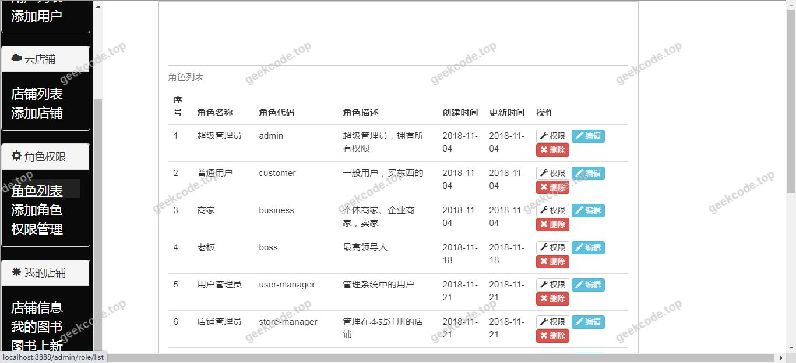
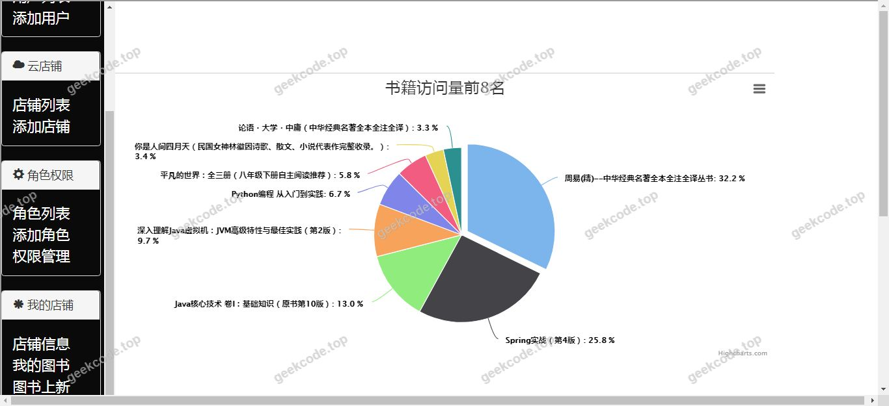

# java精品项目-基于ssm的推荐版在线网上书店系统

> 🎓 **计算机毕业设计 · java精品项目-基于ssm的推荐版在线网上书店系统**
>
> 本仓库只放**项目介绍 + 运行截图**（截图是站点带水印的原图，存在仓库 `images/` 里）。
>
> 👉 **完整可运行源码 / 数据库脚本 / 部署文档：[点我获取](https://geekcode.top/archives/java%E7%B2%BE%E5%93%81%E9%A1%B9%E7%9B%AE-%E5%9F%BA%E4%BA%8Essm%E7%9A%84%E6%8E%A8%E8%8D%90%E7%89%88%E5%9C%A8%E7%BA%BF%E7%BD%91%E4%B8%8A%E4%B9%A6%E5%BA%97%E7%B3%BB%E7%BB%9F?utm_source=github)**
>
> 💬 咨询微信：**ir9372**　|　🌐 更多项目：[极客代码 geekcode.top](https://geekcode.top/?utm_source=github)
>
> 📌 项目详情页：<https://geekcode.top/archives/java%E7%B2%BE%E5%93%81%E9%A1%B9%E7%9B%AE-%E5%9F%BA%E4%BA%8Essm%E7%9A%84%E6%8E%A8%E8%8D%90%E7%89%88%E5%9C%A8%E7%BA%BF%E7%BD%91%E4%B8%8A%E4%B9%A6%E5%BA%97%E7%B3%BB%E7%BB%9F?utm_source=github>

<table><td width="230" align="center"> <b>扫码加微信 ir9372</b></td><td valign="middle">📦 源码 = 项目介绍 + 全部运行截图 + 数据库 + 部署文档 👉 点上方任意截图，直接跳到 <b>极客代码 geekcode.top</b> 详情页</td></table>

---

<h1>java精品项目-基于ssm的推荐版在线网上书店系统</h1>
<h2>项目概述</h2>

本项目为基于 SSM（Spring + Spring MVC + MyBatis）架构的在线网上书店系统，旨在构建一个具备图书推荐功能的电子商务平台。系统核心目标是实现图书信息的数字化管理、用户在线选购以及基于算法或规则的个性化图书推荐服务。适用场景主要面向中小型实体书店的数字化转型需求，以及高校计算机专业对于 Web 应用开发的教学与实践。技术架构上，后端采用 Java 语言结合 Spring Boot 框架进行快速搭建，持久层使用 MyBatis 进行数据库交互，整体遵循 MVC 设计模式，确保代码结构清晰、易于维护与扩展。

<h2>技术架构</h2>
<h3>前后端架构</h3>

根据提供的配置信息，该项目被标记为 JSP 类型且无独立的前后台路由定义，表明其采用传统的服务器端渲染（SSR）模式。前端页面由 JSP（Java Server Pages）配合 JSTL 标签库生成，直接嵌入 HTML 结构中；后端逻辑运行在 Tomcat 容器中，通过 Spring Boot Starter Web 处理 HTTP 请求。这种架构模式下，视图层与控制层耦合度相对较高，但适合快速开发和管理动态内容。

<h3>核心技术选型理由</h3>
<ol>
<li><strong>Spring Boot</strong>: 作为基础框架，利用 <code>spring-boot-starter-web</code> 简化了嵌入式 Tomcat 的配置及 RESTful API 的开发流程，同时 <code>spring-boot-devtools</code> 提供了热部署支持，提升开发效率。</li>
<li><strong>MyBatis</strong>: 通过 <code>mybatis-spring-boot-starter</code> 和 <code>mapper-spring-boot-starter</code> 集成，实现了 SQL 语句与 Java 代码的解耦，便于复杂查询的管理和优化。</li>
<li><strong>PageHelper</strong>: 引入 <code>pagehelper-spring-boot-starter</code> 用于处理分页逻辑，这是电商系统中展示商品列表时的关键性能优化组件。</li>
<li><strong>MySQL</strong>: 使用 <code>mysql-connector-java</code> 作为数据库驱动，保证数据持久化的稳定性。</li>
<li><strong>Shiro</strong>: 虽然依赖列表中未显式列出 Shiro starter，但项目描述中提及使用 Shiro，推测用于权限控制和安全认证模块。</li>
</ol>
<h3>数据库设计要点</h3>

系统基于 MySQL 关系型数据库。根据书店业务逻辑，核心数据表应包含：用户表（存储注册信息及登录凭证）、图书表（存储书名、作者、价格、库存、分类等元数据）、订单表（记录交易流水）、以及可能存在的推荐关联表（用于存储用户偏好与图书之间的映射关系）。

<h2>功能模块</h2>

由于提供的上下文信息中明确标注“是否有前台: 否”、“是否有后台: 否”，且路由菜单为空，仅依据项目名称“基于ssm的推荐版在线网上书店系统”及截图列表中的“系统运行界面”推断，该系统应具备以下基本业务功能模块，但具体细分菜单无法从现有数据中确切提取：

<h3>用户端功能（推测自项目名称）</h3>
<ul>
<li><strong>图书浏览与搜索</strong>：展示图书列表，支持按分类、名称检索。</li>
<li><strong>图书详情查看</strong>：显示单本图书的具体信息。</li>
<li><strong>推荐服务</strong>：根据项目名称，系统应包含图书推荐模块，向用户展示潜在感兴趣的书籍。</li>
<li><strong>购物车与下单</strong>：基本的电商购买流程。</li>
</ul>
<h3>管理端功能（推测自书店系统通用需求）</h3>
<ul>
<li><strong>图书管理</strong>：对图书信息进行增删改查。</li>
<li><strong>订单管理</strong>：查看和处理用户生成的订单。</li>
<li><strong>用户管理</strong>：维护注册用户信息。</li>
</ul>

<em>(注：以上模块为基于项目名称和行业标准的推导，因原始数据缺失具体路由和功能清单，无法提供精确到按钮级的功能描述。)</em>

<h2>用户角色与权限</h2>

根据现有信息，无法确定具体的角色划分及详细的权限矩阵。通常此类书店系统涉及以下角色，但未在源码配置中体现具体权限隔离细节：

<ul>
<li><strong>普通用户</strong>：可执行浏览、搜索、加购、下单等操作。</li>
<li><strong>管理员</strong>：可执行图书上架、下架、订单发货、用户管理等后台操作。</li>
</ul>

由于项目配置文件中未包含具体的安全拦截器路径映射或角色注解信息，无法列出每个角色可访问的具体 URL 或功能模块清单。

<h2>项目特色与创新点</h2>
<ol>
<li><strong>推荐机制集成</strong>：区别于传统静态书店系统，本项目强调“推荐版”，意在通过数据分析或规则引擎为用户提供个性化的图书建议，增强用户粘性和转化率。</li>
<li><strong>经典 SSM 架构实践</strong>：采用成熟的 Spring + Spring MVC + MyBatis 组合，结合了 Spring Boot 的快速启动特性，既保留了传统分层架构的清晰度，又享受了现代微服务框架的开发便捷性。</li>
<li><strong>JSP 服务端渲染优势</strong>：对于 SEO 友好性要求较高的图书展示页面，JSP 技术能确保首屏内容完整加载，无需复杂的客户端 JavaScript 框架支持，降低了前端兼容性问题的风险。</li>
</ol>
<h2>部署环境</h2>

为确保系统正常运行，需准备以下软件环境：

<ul>
<li><strong>JDK</strong>: 版本 1.8 或以上（Spring Boot 2.x 兼容 JDK 8+）。</li>
<li><strong>Maven</strong>: 用于项目依赖管理和打包构建。</li>
<li><strong>MySQL</strong>: 版本 5.7 或 8.0，需创建对应的数据库实例并导入初始数据脚本。</li>
<li><strong>Tomcat</strong>: 若不使用 Spring Boot 内置容器，需安装独立 Tomcat 9.0+；若使用内置容器则无需单独安装。</li>
<li><strong>IDE</strong>: IntelliJ IDEA 或 Eclipse，用于代码开发与调试。</li>
<li><strong>浏览器</strong>: Chrome, Firefox 或 Edge 等主流现代浏览器，用于访问系统界面。</li>
</ul>
<h2>五、技术特性</h2>
<ul>
<li>服务端模板渲染（JSP）</li>
<li>集成 Shiro 权限框架实现角色权限控制</li>
</ul>
<h2>六、功能模块截图</h2>
<h3>前台用户端</h3>
<h4>系统运行界面1</h4>

<h4>系统运行界面2</h4>

<h4>系统运行界面3</h4>

<h4>系统运行界面4</h4>

<h4>系统运行界面5</h4>

<h4>系统运行界面6</h4>

<h4>系统运行界面7</h4>

---

## 获取完整源码

| 项目 | 说明 |
| --- | --- |
| 项目名 | java精品项目-基于ssm的推荐版在线网上书店系统 |
| 运行截图 | 本文 7 张（站点带水印原图，仓库 `images/` 目录） |
| 完整源码 | [https://geekcode.top/archives/java%E7%B2%BE%E5%93%81%E9%A1%B9%E7%9B%AE-%E5%9F%BA%E4%BA%8Essm%E7%9A%84%E6%8E%A8%E8%8D%90%E7%89%88%E5%9C%A8%E7%BA%BF%E7%BD%91%E4%B8%8A%E4%B9%A6%E5%BA%97%E7%B3%BB%E7%BB%9F?utm_source=github](https://geekcode.top/archives/java%E7%B2%BE%E5%93%81%E9%A1%B9%E7%9B%AE-%E5%9F%BA%E4%BA%8Essm%E7%9A%84%E6%8E%A8%E8%8D%90%E7%89%88%E5%9C%A8%E7%BA%BF%E7%BD%91%E4%B8%8A%E4%B9%A6%E5%BA%97%E7%B3%BB%E7%BB%9F?utm_source=github) |
| 咨询微信 | **ir9372**（备注：jingpin-yuanma） |
| 更多项目 | [极客代码 geekcode.top](https://geekcode.top/?utm_source=github) |

> 需要源码、部署、改配置、跑不起来等问题，加微信 ir9372 沟通，说明项目名即可。
